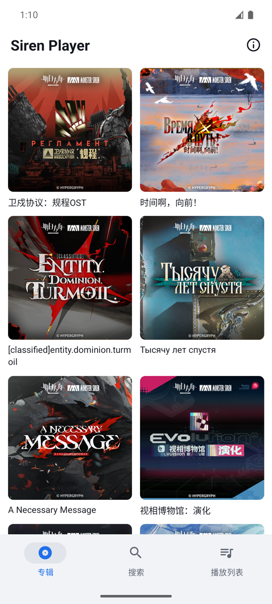
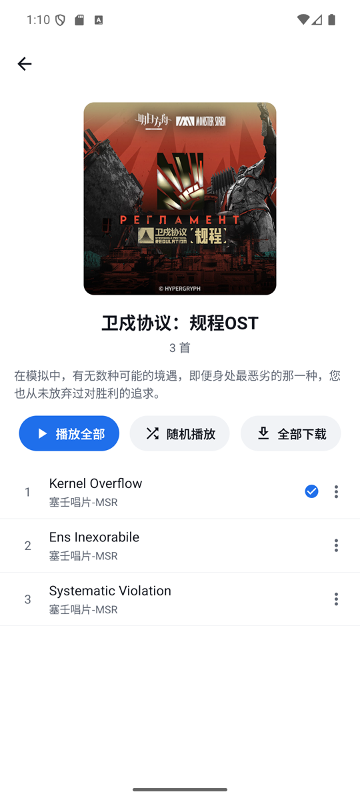
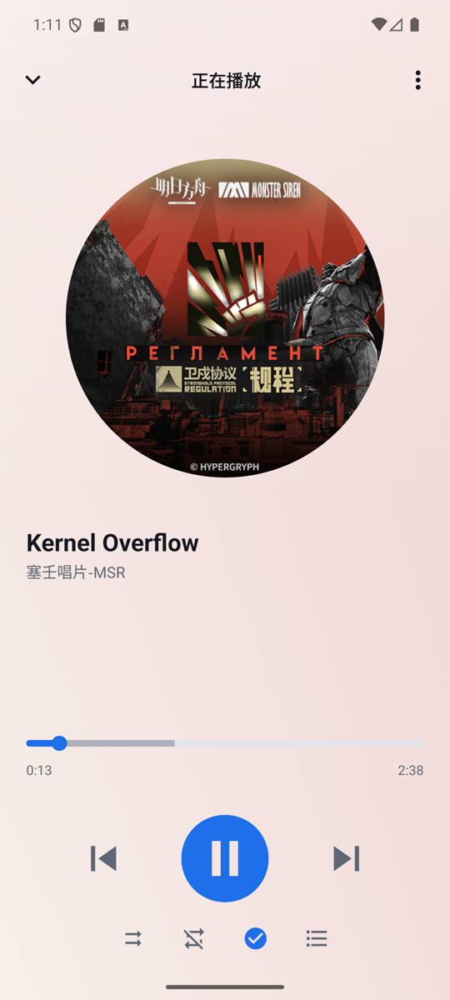
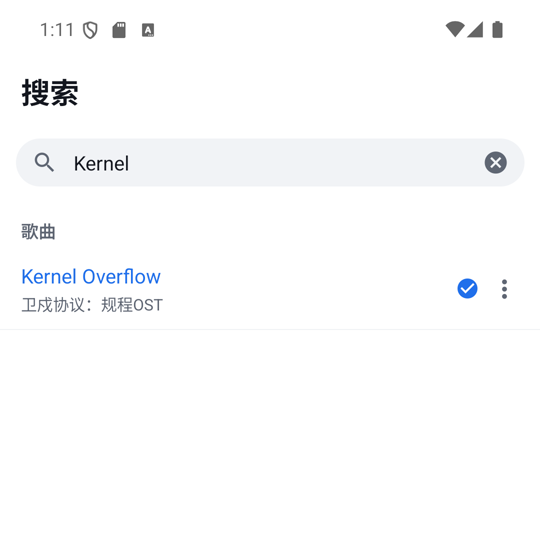
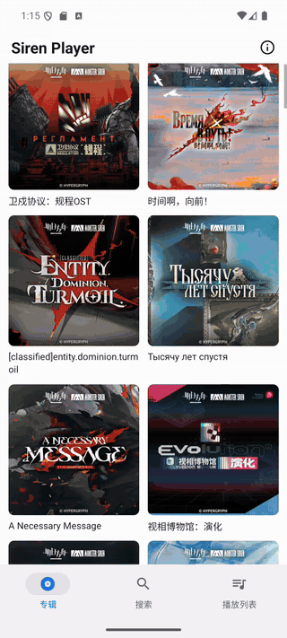

<div align="center">

<h1>Siren Player</h1>

塞壬唱片 Monster Siren Records の曲を再生する，Android 向けの非公式プレーヤー．
アカウント不要．表示言語は中国語．

</div>

---

## 画面のプレビュー

<table>
  <tr>
    <th align="center" width="50%">アルバム</th>
    <th align="center" width="50%">曲の一覧</th>
  </tr>
  <tr>
    <td align="center"></td>
    <td align="center"></td>
  </tr>
  <tr>
    <td align="center">アルバム · 下のタブで検索とプレイリストへ</td>
    <td align="center">すべて再生 · シャッフル · まとめてダウンロード</td>
  </tr>
  <tr>
    <th align="center">再生</th>
    <th align="center">検索</th>
  </tr>
  <tr>
    <td align="center"></td>
    <td align="center"></td>
  </tr>
  <tr>
    <td align="center">カバーの色から作る流れる背景 · 横にスワイプで歌詞</td>
    <td align="center">曲名 · アーティスト · アルバムで検索</td>
  </tr>
</table>

## 使い方

<div align="center">

</div>

1. **アルバムから選ぶ**: ホームのアルバムを押すと，曲の一覧が開く．曲を押すと，そのアルバムをキューにして再生を始める．
2. **プレーヤーを開く**: 画面下の再生バーを押す．横にスワイプすると，歌詞の画面に切り替わる．歌詞の行を押すと，その位置へ移る．
3. **探す**: 下のタブの検索から，曲名，アーティスト，アルバム名で探す．
4. **まとめる**: 曲の右の「︙」から，プレイリストへ追加する．プレイリストは，下のタブから開く．
5. **オフラインで聴く**: 曲の「︙」，またはアルバムの「すべてダウンロード」で，端末に保存する．保存した曲は，通信なしで再生できる．一覧は，プレイリストのタブの「已下载」から開く．

画面を閉じても，再生は続く．通知とロック画面から，操作できる．

## 主要機能

- **ログイン不要**: 公式サイトの公開 API から，アルバムと曲を取得して再生する．
- **プレーヤー**: 前後の曲への移動，シャッフル，繰り返し，再生キューの表示，シークバーの操作．
- **流れる背景**: カバーから色を取り出し，再生画面の背景を動かす．
- **歌詞**: 曲ごとの LRC を取得して表示し，再生に合わせて強調する．歌詞が登録されている曲のみ．
- **検索とプレイリスト**: 全曲の中から探し，自分のプレイリストにまとめる．
- **ダウンロード**: 利用者の指示で，アプリ専用の領域へ保存する．ほかのアプリや共有の場所へは書き出さない．
- **バックグラウンド再生**: 通知とロック画面の操作に対応する．
- **外観**: 端末の設定に合わせて，ライトとダークを切り替える．

MV には対応しない．

## 技術スタック

- **フレームワーク**: React Native，Expo，expo-router
- **データ取得**: TanStack Query
- **再生**: Media3 ベースの自作モジュール [siren-audio](./modules/siren-audio)
- **描画**: Skia，Reanimated
- **色の抽出**: Android Palette を使う [image-theme-colors](./modules/image-theme-colors)

曲の URL は署名付きで期限があるため，再生の直前に `/api/song/{cid}` を引いて音源の場所を得る．

## プロジェクトの構成

| 場所 | 内容 |
| --- | --- |
| [src/](./src) | 画面，API クライアント，歌詞の解析，表示言語の対応表 |
| [modules/siren-audio/](./modules/siren-audio) | Media3 を使う再生サービスと，JS との橋渡し |
| [modules/image-theme-colors/](./modules/image-theme-colors) | カバー画像からの色の抽出 |
| [expo-plugins/](./expo-plugins) | ビルド用の Expo プラグイン |
| [scripts/build-local.ps1](./scripts/build-local.ps1) | Windows での APK のビルド |

## 開発とビルド

必要なもの: Node.js，pnpm，Android SDK，JDK 17 以上．

```powershell
corepack pnpm install
corepack pnpm type-check
corepack pnpm lint
```

Windows では，ビルドのパスが長くなりすぎるため，短いパスの作業ディレクトリで行う．
`scripts/build-local.ps1` が，ソースを作業ディレクトリへ同期して APK を作る．

```powershell
.\scripts\build-local.ps1
```

初回の準備と，署名鍵の設定は，スクリプトの冒頭に書いてある．
署名鍵と `gradle.properties` は，リポジトリに含めない．

文言は，`t('日本語')` の形でソースに書き，`src/i18n/zh.ts` の対応表で中国語に置き換える．

## 免責事項

本アプリは，個人が開発した非公式のアプリケーションであり，塞壬唱片 Monster Siren Records および Hypergryph とは一切関係がない．
曲の音源，歌詞，画像の権利は，塞壬唱片および Hypergryph に帰属する．本リポジトリは，音源と歌詞を含まない．
画面のプレビューには，動作を示すため，アルバムのカバーが写っている．権利者から求められた場合は，速やかに差し替える．
アプリは，公式サイトの公開 API から取得して再生する．ダウンロードした曲の再配布は行わないこと．
公式サイトの利用条件を守って使うこと．公開 API の仕様は予告なく変わり，動作しなくなることがある．
本アプリの利用により生じた損害について，開発者は一切の責任を負わない．利用は，利用者自身の責任において行うものとする．

## 元になったプロジェクト

Siren Player は，Roitium 氏による **[BBPlayer](https://github.com/bbplayer-app/BBPlayer)** と，その派生である BBMusica を基に開発した派生アプリケーションである．
優れたプロジェクトを公開された Roitium 氏に，敬意と感謝を表する．

主な変更点は，[NOTICE.md](./NOTICE.md) を参照．

## プライバシー

情報の取り扱いについては，[PRIVACY.md](./PRIVACY.md) を参照．

## ライセンス

本ソフトウェアは MIT ライセンスのもとで公開している．詳細は [LICENSE](./LICENSE) を参照．

---

<details>
<summary>English</summary>

Siren Player is an unofficial Android player for Monster Siren Records, built on top of
[BBPlayer](https://github.com/bbplayer-app/BBPlayer) by Roitium and its derivative BBMusica under the MIT license.
No account is needed. The UI is in Chinese. It is not affiliated with Monster Siren Records or Hypergryph.
Songs, lyrics and images belong to their rights holders. Audio and lyrics are not included in this repository; the screenshots show album covers only to illustrate the app.

</details>
